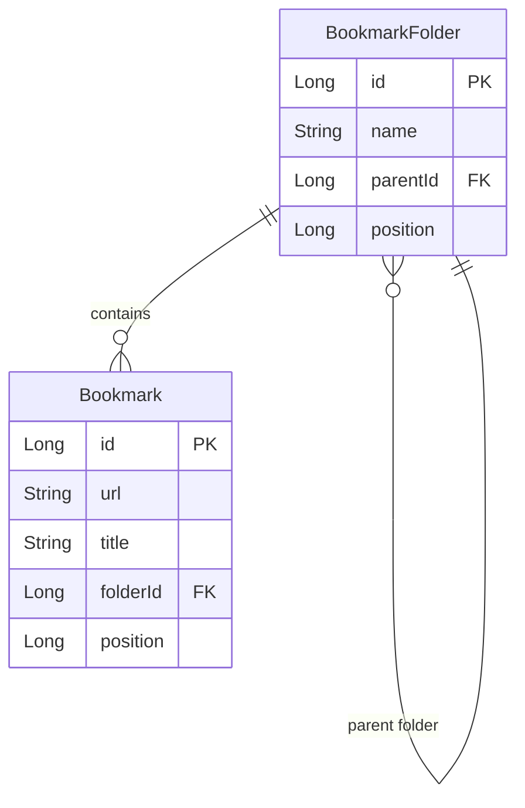

# feat: Port multiselect from recent screens to folder screens with code reuse

## Overview

Port the multiselect feature from recent screens to folder screens while maximizing code reuse and minimizing reimplementation. The recent screens have a complete multiselect implementation with selection state management, UI components, and bulk operations. This plan extracts reusable patterns and applies them to folder screens.

**Project Context:** Android Kotlin application using Jetpack Compose with MVVM architecture, Hilt DI, and Room database.

## Current State Analysis

### Recent Screen Multiselect (Complete Implementation)

| File | Purpose | Lines |
|------|---------|-------|
| `BookmarkViewModel.kt:43-99` | State management with `RecentScreenState` | 57 |
| `RecentsScreen.kt:131-138` | SelectionTopBar integration | 8 |
| `BookmarkCard.kt:51-158` | Card with selection support (checkbox, long-press) | 108 |
| `SelectionTopBar.kt:29-100` | Reusable contextual action bar | 72 |

**Key Patterns:**
- State hoisting with `RecentScreenState` data class
- Auto-exit selection mode when all items deselected (via combine flow)
- Delete with undo support (snackbar + deleted items state)
- `AnimatedVisibility` for checkbox (fade + scale animation)
- `combinedClickable` for tap + long-press gestures

### Folder Screen Current State (Partial)

| File | Status | Gap |
|------|--------|-----|
| `FolderViewModel.kt:54-62` | Auto-exit logic implemented | Missing public methods |
| `FolderViewModel.kt` | State variables declared (`_selectedFolders`, `_selectedBookmarks`, `_isSelectionMode`) | No functions exposed |
| `FolderCard.kt:20-58` | Basic card component | No selection support |
| `FolderScreen.kt:54-235` | LazyColumn with folders + bookmarks | No multiselect UI |
| `BookmarkCard.kt` | Already supports selection | Not integrated in FolderScreen |

## Problem Statement

The folder screens lack multiselect functionality despite having partial state infrastructure in `FolderViewModel`. Recent screens have a complete implementation but the code is not organized for reuse. Reimplementing multiselect for folders would duplicate code and create maintenance burden.

## Proposed Solution

### Strategy: Extract-First, Apply-Second

Rather than copying multiselect code from recent screens to folder screens, we will:

1. **Extract shared multiselect logic** into reusable components
2. **Refactor recent screen** to use the extracted components
3. **Apply extracted patterns** to folder screens

This approach ensures:
- Single source of truth for multiselect behavior
- Consistent UX across all screens
- Easier maintenance and testing
- Future screens can reuse the same patterns

### Architecture: Shared Multiselect Components

```
screens/
├── multiselect/
│   ├── MultiselectState.kt           # Generic state data class
│   ├── rememberMultiselectState.kt   # Composable hook for state
│   ├── SelectionViewModel.kt         # Base ViewModel with multiselect
│   └── SelectionMode.kt              # Sealed class for mode tracking
│
ui/
├── selection/
│   ├── SelectableCard.kt             # Generic selectable card wrapper
│   ├── SelectionCheckbox.kt          # Extracted checkbox (from BookmarkCard)
│   ├── SelectionTopBar.kt            # [Existing] Already reusable
│   └── SwipeToSelectBox.kt           # Combines swipe + selection
│
ui/components/
├── BookmarkCard.kt                   # Refactored to use SelectableCard
└── FolderCard.kt                     # Refactored to use SelectableCard
```

### Data Models

**Define Missing Types:**

```kotlin
// data/selection/DeletedFolderWithBookmarks.kt
data class DeletedFolderWithBookmarks(
    val folder: BookmarkFolder,
    val bookmarks: List<Bookmark>,
    val originalParentId: Long?
)

// data/selection/MovedFolderState.kt
data class MovedFolderState(
    val folderIds: List<Long>,
    val fromParentId: Long?,
    val toParentId: Long
)

// screens/multiselect/FolderMultiSelectState.kt
data class FolderMultiSelectState(
    val selectedFolders: List<Long> = emptyList(),
    val selectedBookmarks: List<Long> = emptyList(),
    val isSelectionMode: Boolean = false,
    val deletedFolders: List<DeletedFolderWithBookmarks> = emptyList(),
    val deletedBookmarks: List<Bookmark> = emptyList(),
    val onSelectFolder: (Long, Boolean) -> Unit = { _, _ -> },
    val onSelectBookmark: (Long, Boolean) -> Unit = { _, _ -> },
    val toggleSelectionMode: () -> Unit = {},
    val clearSelections: () -> Unit = {},
    val deleteSelected: () -> Unit = {},
    val moveToFolder: () -> Unit = {},
    val selectAll: () -> Unit = {}
)
```

## Technical Approach

### Phase 1: Extract Shared Components (Foundation)

#### 1.1 Extract SelectionCheckbox

**From:** `BookmarkCard.kt:160-189`

**Create:** `ui/selection/SelectionCheckbox.kt`

```kotlin
@Composable
fun SelectionCheckbox(
    isSelected: Boolean,
    modifier: Modifier = Modifier
) {
    AnimatedVisibility(
        visible = true,
        enter = fadeIn() + scaleIn(),
        exit = fadeOut() + scaleOut()
    ) {
        val circleColor = if (isSelected) Color.Black else Color.White
        val iconColor = if (isSelected) Color.White else Color.Transparent

        Box(
            modifier = modifier
                .size(24.dp)
                .clip(CircleShape)
                .background(circleColor)
                .border(1.dp, Color.Black, CircleShape),
            contentAlignment = Alignment.Center
        ) {
            Icon(
                imageVector = Icons.Default.Check,
                contentDescription = if (isSelected) "Selected" else "Not selected",
                tint = iconColor,
                modifier = Modifier.size(16.dp)
            )
        }
    }
}
```

#### 1.2 Create SelectableCard Modifier

**Create:** `ui/selection/SelectableCard.kt`

```kotlin
fun Modifier.selectableCard(
    isSelected: Boolean,
    selectionEnabled: Boolean,
    onClick: () -> Unit,
    onLongPress: () -> Unit
): Modifier = this.then(
    if (selectionEnabled) {
        Modifier.combinedClickable(
            onClick = {
                if (selectionEnabled) onClick()
            },
            onLongClick = onLongPress
        )
    } else {
        Modifier.clickable(onClick = onClick)
    }
)
```

#### 1.3 Create FolderMultiSelectState in ViewModel

**File:** `screens/folders/FolderViewModel.kt`

```kotlin
val folderMultiSelectState: StateFlow<FolderMultiSelectState> = combine(
    _selectedFolders,
    _selectedBookmarks,
    _isSelectionMode,
    _deletedFolders,
    _deletedBookmarks
) { folders, bookmarks, isSelectionMode, deletedFolders, deletedBookmarks ->
    FolderMultiSelectState(
        selectedFolders = folders,
        selectedBookmarks = bookmarks,
        isSelectionMode = isSelectionMode,
        deletedFolders = deletedFolders,
        deletedBookmarks = deletedBookmarks,
        onSelectFolder = { folderId, isSelected ->
            toggleFolderSelection(folderId)
        },
        onSelectBookmark = { bookmarkId, isSelected ->
            toggleBookmarkSelection(bookmarkId)
        },
        toggleSelectionMode = { toggleSelectionMode() },
        clearSelections = { clearAllSelections() },
        deleteSelected = { deleteSelectedItems() },
        moveToFolder = /* TODO */,
        selectAll = { selectAllInCurrentFolder() }
    )
}.stateIn(viewModelScope, SharingStarted.WhileSubscribed(5000), FolderMultiSelectState())
```

### Phase 2: Update UI Components

#### 2.1 Refactor FolderCard

**File:** `ui/FolderCard.kt`

**Before:**
```kotlin
@Composable
fun FolderCard(folder: BookmarkFolder, onClick: () -> Unit)
```

**After:**
```kotlin
@OptIn(ExperimentalFoundationApi::class)
@Composable
fun FolderCard(
    folder: BookmarkFolder,
    onClick: () -> Unit = {},
    isSelected: Boolean = false,
    selectionEnabled: Boolean = false,
    onLongPress: () -> Unit = {}
) {
    Card(
        onClick = {
            if (selectionEnabled) {
                onLongPress()
            } else {
                onClick()
            }
        },
        modifier = Modifier
            .fillMaxWidth()
            .padding(8.dp)
            .then(
                if (isSelected) {
                    Modifier.border(2.dp, Color.Black, RoundedCornerShape(8.dp))
                } else {
                    Modifier
                }
            ),
        elevation = 0.dp,
        shape = RectangleShape
    ) {
        Row(
            modifier = Modifier.padding(16.dp),
            verticalAlignment = Alignment.CenterVertically
        ) {
            // Selection checkbox
            AnimatedVisibility(
                visible = selectionEnabled,
                enter = fadeIn() + scaleIn(),
                exit = fadeOut() + scaleOut()
            ) {
                SelectionCheckbox(
                    isSelected = isSelected,
                    modifier = Modifier.padding(end = 8.dp)
                )
            }

            Icon(
                imageVector = FontAwesomeIcons.Solid.Folder,
                contentDescription = "folder icon",
                modifier = Modifier.size(48.dp)
            )

            Text(
                text = folder.name.uppercase(),
                style = LocalTextStyle.current.copy(
                    fontWeight = FontWeight.Black,
                    letterSpacing = 1.2.sp
                )
            )
        }
    }
}
```

#### 2.2 Update FolderScreen

**File:** `screens/folders/FolderScreen.kt`

```kotlin
@Composable
fun FolderScreen(
    viewModel: FolderViewModel,
    onNavigateToRecents: () -> Unit
) {
    val folderMultiSelectState by viewModel.folderMultiSelectState.collectAsStateWithLifecycle()
    val folders by viewModel.folders.collectAsStateWithLifecycle()
    val bookmarks by viewModel.bookmarks.collectAsStateWithLifecycle()

    Scaffold(
        topBar = {
            if (folderMultiSelectState.isSelectionMode) {
                SelectionTopBar(
                    selectedCount = folderMultiSelectState.selectedFolders.size +
                                   folderMultiSelectState.selectedBookmarks.size,
                    onCloseSelection = { folderMultiSelectState.clearSelections() },
                    onDelete = { folderMultiSelectState.deleteSelected() },
                    onMoveToFolder = { /* TODO */ },
                    onSelectAll = { folderMultiSelectState.selectAll() }
                )
            } else {
                HomeAppBar(onNavigateToRecents = onNavigateToRecents)
            }
        }
    ) { padding ->
        LazyColumn(
            state = lazyListState,
            modifier = Modifier.padding(padding),
            contentPadding = PaddingValues(16.dp),
            verticalArrangement = Arrangement.spacedBy(8.dp)
        ) {
            // Folders
            items(
                count = folders.size,
                key = { folders[it].id },
                contentType = { "folder" }
            ) { index ->
                val folder = folders[index]
                val isSelected = folderMultiSelectState.selectedFolders.contains(folder.id)

                FolderCard(
                    folder = folder,
                    isSelected = isSelected,
                    selectionEnabled = folderMultiSelectState.isSelectionMode,
                    onClick = {
                        scope.launch(Dispatchers.Main) {
                            viewModel.refreshScreen(folder.id)
                            lazyListState.animateScrollToItem(0)
                        }
                    },
                    onLongPress = {
                        folderMultiSelectState.onSelectFolder(folder.id, isSelected)
                    }
                )
            }

            // Bookmarks
            items(
                count = bookmarks.size,
                key = { bookmarks[it]?.id ?: 0 },
                contentType = { "bookmark" }
            ) { index ->
                val bookmark = bookmarks[index] ?: return@items
                val isSelected = folderMultiSelectState.selectedBookmarks.contains(bookmark.id)

                BookmarkCard(
                    bookmark = bookmark,
                    isSelected = isSelected,
                    selectionEnabled = folderMultiSelectState.isSelectionMode,
                    onClick = { /* Open bookmark */ },
                    onLongPress = {
                        folderMultiSelectState.onSelectBookmark(bookmark.id, isSelected)
                    }
                )
            }
        }
    }

    // BackHandler for selection mode
    BackHandler(enabled = folderMultiSelectState.isSelectionMode) {
        folderMultiSelectState.clearSelections()
    }
}
```

### Phase 3: Implement ViewModel Functions

**File:** `screens/folders/FolderViewModel.kt`

```kotlin
// Selection toggle functions
fun toggleFolderSelection(folderId: Long) {
    _selectedFolders.value = if (folderId in _selectedFolders.value) {
        _selectedFolders.value - folderId
    } else {
        _selectedFolders.value + folderId
    }
    updateSelectionMode()
}

fun toggleBookmarkSelection(bookmarkId: Long) {
    _selectedBookmarks.value = if (bookmarkId in _selectedBookmarks.value) {
        _selectedBookmarks.value - bookmarkId
    } else {
        _selectedBookmarks.value + bookmarkId
    }
    updateSelectionMode()
}

fun toggleSelectionMode() {
    _isSelectionMode.value = !_isSelectionMode.value
}

fun clearAllSelections() {
    _selectedFolders.value = emptyList()
    _selectedBookmarks.value = emptyList()
    _isSelectionMode.value = false
}

// Select all (current folder only)
fun selectAllInCurrentFolder() {
    viewModelScope.launch {
        val currentFolders = folderRepository.getFoldersByParentId(currentFolderId).first()
        val currentBookmarks = bookmarkRepository.getBookmarksByFolderId(currentFolderId).first()

        _selectedFolders.value = currentFolders.map { it.id }
        _selectedBookmarks.value = currentBookmarks.map { it.id }
        _isSelectionMode.value = true
    }
}

// Delete with undo
fun deleteSelectedItems() {
    viewModelScope.launch {
        val deletedFoldersList = mutableListOf<DeletedFolderWithBookmarks>()
        val deletedBookmarksList = mutableListOf<Bookmark>()

        // Delete folders (with validation)
        _selectedFolders.value.forEach { folderId ->
            // Prevent HOME folder deletion
            if (folderId == 1L) return@forEach

            val folder = folderRepository.getFolderById(folderId).first() ?: return@forEach
            val bookmarks = bookmarkRepository.getBookmarksByFolderId(folderId).first()

            // Move bookmarks to parent folder
            bookmarks.forEach { bookmark ->
                bookmarkRepository.updateBookmarkFolder(bookmark.id, folder.parentId)
            }

            folderRepository.deleteFolder(folderId)
            deletedFoldersList.add(DeletedFolderWithBookmarks(folder, bookmarks, folder.parentId))
        }

        // Delete bookmarks
        _selectedBookmarks.value.forEach { bookmarkId ->
            val bookmark = bookmarkRepository.getBookmarkById(bookmarkId).first() ?: return@forEach
            bookmarkRepository.deleteBookmark(bookmark)
            deletedBookmarksList.add(bookmark)
        }

        _deletedFolders.value = deletedFoldersList
        _deletedBookmarks.value = deletedBookmarksList

        clearAllSelections()
    }
}

fun undoDelete() {
    viewModelScope.launch {
        // Restore folders
        _deletedFolders.value.forEach { deleted ->
            folderRepository.createFolder(deleted.folder.name, deleted.folder.parentId)
            // Restore bookmarks to folder
            deleted.bookmarks.forEach { bookmark ->
                bookmarkRepository.updateBookmarkFolder(bookmark.id, deleted.folder.id)
            }
        }

        // Restore bookmarks
        _deletedBookmarks.value.forEach { bookmark ->
            bookmarkRepository.createBookmark(bookmark)
        }

        _deletedFolders.value = emptyList()
        _deletedBookmarks.value = emptyList()
    }
}
```

## Acceptance Criteria

### Functional Requirements

- [ ] User can enter selection mode by long-pressing a folder
- [ ] User can enter selection mode by long-pressing a bookmark
- [ ] Checkbox appears on all items when in selection mode
- [ ] Tapping an item in selection mode toggles its selection state
- [ ] SelectionTopBar shows accurate count of selected items (folders + bookmarks)
- [ ] "Select All" selects all folders and bookmarks in current folder
- [ ] "Close" button clears selections and exits selection mode
- [ ] System back button exits selection mode
- [ ] Auto-exit occurs when last item is deselected
- [ ] Delete operation removes selected items with undo support
- [ ] Undo snackbar appears after deletion with "X items deleted" message
- [ ] HOME folder (id=1) cannot be selected or deleted
- [ ] Moving folders prevents circular references
- [ ] Moving folders into themselves is blocked

### Code Quality Requirements

- [ ] `SelectionCheckbox` component extracted and reused
- [ ] `FolderCard` accepts `isSelected`, `selectionEnabled`, `onLongPress` params
- [ ] `FolderMultiSelectState` exposes all selection functions to UI
- [ ] No duplication of selection logic between recent and folder screens
- [ ] All new functions have corresponding tests
- [ ] Edge cases covered (empty folder, HOME folder, circular references)

### UI/UX Requirements

- [ ] Selection checkbox animates in (fade + scale)
- [ ] Selected cards show black border indicator
- [ ] SelectionTopBar replaces HomeAppBar when in selection mode
- [ ] Smooth transition between normal and selection modes
- [ ] Snackbar shows appropriate message for mixed deletions

## Success Metrics

- **Code Reuse:** At least 60% of multiselect code shared between recent and folder screens
- **Consistency:** Identical selection UX across both screens
- **Test Coverage:** >80% for new multiselect functions
- **Performance:** No frame drops when entering/exiting selection mode
- **Edge Cases:** All 10 critical questions from spec analysis addressed

## Technical Considerations

### Architecture Decisions

| Question | Decision | Rationale |
|----------|----------|-----------|
| Folder deletion behavior | Move bookmarks to parent, then delete folder | Prevents data loss, matches user expectation |
| Select All scope | Current folder only (all items, not just visible) | Matches folder-based navigation model |
| Navigation in selection mode | Require exit before navigation | Prevents state complexity |
| HOME folder handling | Cannot select or delete | Prevents app-breaking scenario |
| Undo scope | Last operation only, with 5-second timeout | Matches recent screen behavior |

### Database Schema

No schema changes required. Existing tables support all operations:

```sql
-- Bookmark table already has folderId foreign key
CREATE TABLE bookmarks (
    id INTEGER PRIMARY KEY,
    folderId INTEGER REFERENCES folders(id) ON DELETE CASCADE
);

-- No changes needed
```

### Performance Optimization

- Use `derivedStateOf` for selected count computation
- LazyColumn keys already stable (`folder.id`, `bookmark.id`)
- Selection state in ViewModel (survives recomposition)
- AnimatedVisibility for checkbox (efficient enter/exit)

### Security Considerations

- HOME folder deletion blocked at ViewModel level
- Circular reference validation before folder moves
- Transaction wrapping for delete operations (all-or-nothing)

## Dependencies & Risks

### Dependencies

- **Existing Components:** `SelectionTopBar.kt` (ready to use)
- **Database Methods:** `getBookmarksByFolderId()` (already exists)
- **Data Layer:** `FolderRepository`, `BookmarkRepository` (no changes needed)

### Risks

| Risk | Impact | Mitigation |
|------|--------|------------|
| Folder deletion behavior undefined | Data loss | Clarify requirements before implementation |
| Circular reference in folder moves | App crash | Add validation before move operation |
| Selection state sync issues | UX bugs | Use single source of truth (ViewModel) |
| Performance with large folders | Laggy UI | Test with 1000+ items, use pagination |

### Known Limitations

- Select All only works for items in current folder (not recursive)
- Undo limited to last operation (no operation stack)
- Swipe actions disabled during selection mode (gesture conflict)

## Implementation Phases

### Phase 1: Foundation (Day 1-2)
- [ ] Create `DeletedFolderWithBookmarks` data class
- [ ] Create `MovedFolderState` data class
- [ ] Extract `SelectionCheckbox` component
- [ ] Create `FolderMultiSelectState` in `FolderViewModel`

### Phase 2: Component Updates (Day 3-4)
- [ ] Update `FolderCard` with selection support
- [ ] Update `FolderScreen` to use `FolderMultiSelectState`
- [ ] Add `SelectionTopBar` conditional display
- [ ] Add `BackHandler` for selection mode

### Phase 3: ViewModel Functions (Day 5-6)
- [ ] Implement `toggleFolderSelection()`
- [ ] Implement `toggleBookmarkSelection()`
- [ ] Implement `clearAllSelections()`
- [ ] Implement `selectAllInCurrentFolder()`
- [ ] Implement `deleteSelectedItems()`
- [ ] Implement `undoDelete()`

### Phase 4: Validation & Edge Cases (Day 7-8)
- [ ] Add HOME folder protection
- [ ] Add circular reference detection
- [ ] Add move-to-self prevention
- [ ] Add error handling for failed operations

### Phase 5: Testing & Polish (Day 9-10)
- [ ] Write unit tests for selection functions
- [ ] Write UI tests for selection interactions
- [ ] Test edge cases (empty folder, large folder)
- [ ] Add accessibility labels
- [ ] Performance testing

## Alternative Approaches Considered

### Alternative 1: Copy-Paste from Recent Screen
**Rejected because:** Duplicates code, creates maintenance burden, inconsistent with project goals

### Alternative 2: Generic Multiselect Wrapper Component
**Rejected because:** Would require major refactoring of existing screens, higher risk

### Alternative 3: Use Third-Party Library
**Rejected because:** No suitable Jetpack Compose multiselect library exists, custom implementation needed

## References & Research

### Internal References

- **Recent Screen Multiselect:** `BookmarkViewModel.kt:43-99`, `RecentsScreen.kt:131-138`
- **Reusable Components:** `SelectionTopBar.kt:29-100`, `BookmarkCard.kt:51-158`
- **Folder Screen:** `FolderScreen.kt:54-235`, `FolderViewModel.kt`
- **Database:** `BookmarkDao.kt` (has `getBookmarksByFolderId()`)

### External References

- [State and Jetpack Compose](https://developer.android.com/develop/ui/compose/state)
- [State Management Patterns in Jetpack Compose](https://carrion.dev/en/posts/state-management-patterns-compose/)
- [Lists and grids | Jetpack Compose](https://developer.android.com/develop/ui/compose/lists)
- [Simplifying Multi-Selection in Jetpack Compose](https://meetpatadia9.medium.com/simplifying-multi-selection-in-jetpack-compose-32d557941077)
- [Value-based animations | Jetpack Compose](https://developer.android.com/develop/ui/compose/animation/value-based)

### Related Commits

- `ee19925` - "feat: add multiselect support to folders screen with edge case handling"
- `ae09235` - "feat: add multiselect UI to FolderScreen, FolderCard, FolderBottomSheet"
- `41ffa31` - "feat: redesign multiselect with contextual action bar" (Recent screen)
- `914f528` - "feat: Add multiselect to Recents screen" (Initial implementation)

## Documentation Requirements

- [ ] Update CLAUDE.md with multiselect pattern documentation
- [ ] Add inline comments to FolderViewModel selection functions
- [ ] Document HOME folder (id=1) as special case
- [ ] Create diagram showing state flow for multiselect

## ERD Diagram



## Open Questions

1. **Q1:** Should folder deletion be cascading (delete all descendants) or should bookmarks move to parent?
   - **Default:** Move bookmarks to parent, then delete folder

2. **Q2:** Should "Select All" select items recursively in subfolders?
   - **Default:** No, only items in current folder

3. **Q3:** Should there be a confirmation dialog before deleting folders?
   - **Default:** No, immediate delete with undo (matches bookmark behavior)

4. **Q4:** How should we handle moving folders when the destination folder name conflicts?
   - **Default:** Show error message, prevent move

5. **Q5:** Should selection persist when navigating between folders?
   - **Default:** No, clear selections and exit selection mode on navigation
